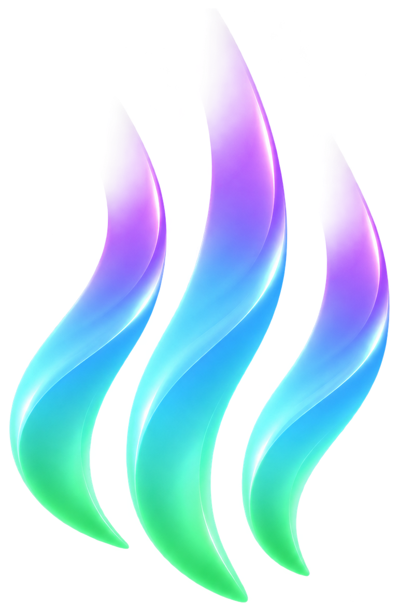

<p align="center">
  
</p>

<h1 align="center">aurora</h1>

<p align="center">A macOS for Linux, built from scratch: Hyprland, a Quickshell shell and my own liquid glass.</p>

aurora is my NixOS desktop: Hyprland plus a Quickshell (QML) shell designed as if Apple had made a macOS for Linux. It has a full-width menu bar, menus that grow out of what you clicked, a Control Center, notifications, a Spotlight-style launcher and a lock screen, all on a live liquid glass material of my own. Everything here is written from scratch; nothing is copied from other rices.

It's a personal desktop, published so others can read it, borrow ideas or run it. It targets one machine (a laptop with a 2880×1800 panel at scale 2, x86_64), so expect to adjust monitors and apps to yours.

## What's in it

- **Liquid glass** (`shell/shaders/glass.frag`, `shell/components/Glass.qml`). A Wayland client can't read what's behind it, so each glass window rebuilds its backdrop: the wallpaper plus live screen captures of the windows under it, blurred, then refracted at a lit rim with chromatic dispersion. Interactive glass lifts under a press; control knobs lift into a magnifying lens while they move and land with a squash and a rebound.
- **Menu bar.** The system menu, the frontmost app's menu (windows, desktops, quit), workspaces as page dots, CPU, GPU and memory as rings in the middle (their menu adds temperatures, network, disk and the top processes, which can be quit from there), other apps' tray extras with their menus, sound, Bluetooth, network and battery extras, Control Center and the clock.
- **Menus.** Every menu and popover pops out of its button as a drop of glass, swells into its shape and melts back on close, with timings fitted frame by frame to Apple's WWDC25 footage.
- **Control Center.** A panel of glass with toggles, sliders, Now Playing and pages for Wi-Fi, Bluetooth, sound outputs and power modes.
- **Notifications.** Banners, and a Notification Center grouped by app with Clear All and a month calendar.
- **Launcher.** Spotlight-style search over every installed app, a calculator and the clipboard history.
- **Window switcher** (Alt+Tab) with live thumbnails, **wallpaper picker** (Super+C) with an accent color taken from the wallpaper, **OSDs** for volume and brightness, **screenshots and screen recording** with an annotation editor, and a **Settings** app.
- **Lock screen** (`shell/lock.qml`, its own process, real PAM) and an **SDDM login theme** (`login/`).
- **Glass window rims**: a Hyprland plugin (`plugins/rims/`) that draws the liquid glass edge around windows.
- **English and Spanish** everywhere; the language follows the system locale.

## Design rules

- Follow Apple's Human Interface Guidelines, but with open fonts (Inter) and my own monochrome icons. SF Pro, SF Symbols and Apple's wallpapers are licensed for Apple platforms only and aren't used here.
- Liquid glass only on the navigation layer. Motion only where it explains a change, always with a Reduce Motion fallback; Reduce Transparency swaps glass for opaque fills.
- Every visible string is translated as it's added (`shell/i18n/`), and `nix flake check` fails if one isn't.

The full design system (tokens, glass presets, springs and their measurements, QML patterns learned the hard way, how to verify work) lives in `.claude/skills/aurora-design/`. It's written as a skill for Claude Code, which I build aurora with, but it reads fine as plain documentation.

## Using it

aurora is a flake. It exports:

| Output | What it is |
|---|---|
| `packages.x86_64-linux.aurora-shell` (`default`) | The shell's QML tree with its shaders compiled |
| `packages.x86_64-linux.aurora-login` | The SDDM theme; `.override { language = "es"; }` |
| `packages.x86_64-linux.aurora-rims` | The rims plugin, built against the pinned Hyprland |
| `homeManagerModules.default` | Links the shell and the Hyprland config into place |

In your system flake:

```nix
inputs.aurora.url = "github:Niiihuel/aurora";
```

Then in Home Manager:

```nix
imports = [ inputs.aurora.homeManagerModules.default ];
aurora.shell.enable = true;     # ~/.config/quickshell/aurora
aurora.hyprland.enable = true;  # ~/.config/hypr/hyprland.lua and hypr/aurora/
```

`hypr/aurora/start.lua` starts `scripts/aurora-session.sh` from `~/projects/personal/aurora`; point it at your clone. That script keeps the shell, the lock screen and the rims running and restarts them if they exit. It loads the rims plugin from the path in the `AURORA_RIMS_SO` session variable, which your NixOS config sets to `${aurora-rims}/lib/libaurora-rims.so`. The SDDM theme goes in `services.displayManager.sddm.theme`.

Things to know before running it:

- **Hyprland is pinned to an exact commit** in `flake.nix`. Plugins must be built against the Hyprland that runs them, so your system should use the same commit (or rebuild `aurora-rims` against yours).
- The Hyprland config is Lua (Hyprland's Lua config). Monitors are in `hypr/aurora/monitors.lua` and apps launched by key bindings (kitty, Dolphin) in `hypr/aurora/binds.lua`. A `~/.config/hypr/private.lua`, if present, is loaded last for your own additions.
- Runtime tools it calls: `awww` (wallpapers), `cliphist` and `wl-clipboard`, `hyprpicker`, `grim`, `pw-play` (PipeWire), NetworkManager and BlueZ.

## Default shortcuts

| Keys | Action |
|---|---|
| Super+Space / Super+V | Launcher / clipboard history |
| Alt+Tab, Alt+\` | Switch windows / windows of this app |
| Super+C, Super+B | Wallpaper picker / next wallpaper |
| Super+Shift+S, Print | Screenshot (region / screen) |
| Super+D | Record the screen |
| Super+L | Lock |
| Super+Q, Super+F, Super+T, Super+M | Close, full screen, float, minimize |
| Super+1…0, Super+←/→ | Go to a desktop / the previous or next one |

They can be changed in Settings → Keyboard.

## Developing

```sh
nix develop                      # quickshell, qsb, qmllint, grim, imagemagick
quickshell -p shell              # run the shell from the repo
quickshell -p shell/gallery.qml  # foundations gallery: type, colors, glass presets, springs
scripts/shaders.sh               # compile shaders (restart the shell afterwards)
nix flake check                  # translations and the JS unit tests
```

With `aurora.shell.devPath` / `aurora.hyprland.devPath` set to this repo's `shell/` and `hypr/`, the Home Manager module links them live: Quickshell hot-reloads every QML save and Hyprland reloads its config. Shaders are the exception: Qt caches a loaded shader for the life of the process, so restart the shell after `scripts/shaders.sh`.

## Layout

- `shell/` — the Quickshell shell. `core/` holds the singletons (tokens, motion, settings, i18n), `components/` the shared pieces (Glass, GlassMorph, controls), `services/` the system state, and one folder per surface (`bar/`, `menus/`, `launcher/`, `switcher/`, `notifications/`, `osd/`, `lock/`, `capture/`, `annotate/`, `wallpaper/`, `settings/`).
- `hypr/` — the Hyprland config (Lua).
- `plugins/rims/` — the Hyprland plugin for the glass window rims.
- `login/` — the SDDM login screen; `nix/login.nix` packages it.
- `nix/` — packages and the Home Manager module.
- `scripts/` — the session supervisor, a Settings launcher, the shader build and the translation check.
- `assets/` — the aurora logo; the system menu's mark is traced from it.

## Roadmap

Built one section at a time, each verified with logs, screenshots and frame timing before the next:

1. Foundations — flake, design tokens, motion presets, the glass material
2. Menu bar
3. Menus for the menu bar extras
4. Control Center
5. Notifications
6. Launcher
7. OSDs
8. Lock screen
9. Window chrome and Hyprland plugins (glass rims, Alt+Tab)
10. Hyprland config, login screen and app colors

All ten are in place; current work is polish (motion fitted to Apple's footage, glass optics).

## License

MIT — see `LICENSE`. Inter and the other fonts and tools aurora uses keep their own licenses.
